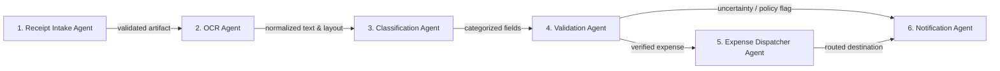

# ReceiptAI — Full-Stack AI Receipt Extraction System

ReceiptAI is a local-first, full-stack receipt extraction and expense tracking web application built with **Next.js App Router**, **FastAPI**, **SQLite**, and **100% free local OCR/PDF processing** (`PyMuPDF`, `Pillow`, and `RapidOCR`).

It lets users upload JPG, JPEG, PNG, or PDF receipts, extracts structured data (merchant name, date, line items, subtotal, tax, tip, and grand total), flags uncertain or missing fields, persists everything in SQLite, and lets users review, edit, search, filter, sort, and delete receipts from a responsive SaaS dashboard.

---

## Features

- **Drag-and-Drop & Browse Upload**: Accepts `.jpg`, `.jpeg`, `.png`, and `.pdf` up to 10 MB with live upload progress, validation, and error feedback.
- **Real Local Document & OCR Pipeline**:
  - Extracts embedded text directly from text-based PDFs using `PyMuPDF`.
  - Renders scanned PDFs and preprocesses image receipts (EXIF auto-rotation, smart resizing, contrast normalization) before running local `RapidOCR` (ONNX PaddleOCR).
  - Deterministically parses merchant name, receipt date, line items, subtotal, tax, tip, and grand total.
  - Preserves missing values as `null` rather than inventing numbers, and flags arithmetic mismatches or low-confidence fields for user review.
- **Persistent SQLite Storage**: Stores receipts in `backend/receipts.db` with migration-safe startup initialization (`init_db()`).
- **Interactive Dashboard**:
  - **Overview**: Real-time Total Expenses, Receipts Processed, and Average Expense computed directly from SQLite records, alongside Quick Upload and Recent Receipts.
  - **All Receipts**: Search by merchant or filename, filter by status (`All`, `Processed`, `Needs Review`, `Failed`), sort by date or total amount, and open any receipt to view/edit/delete.
  - **Review & Edit Modal**: Inspect uncertain field warnings, raw OCR text, add/edit/remove line items, and save manual corrections via `PUT /receipts/{id}`.

---

## Technology Stack

| Layer | Technology |
| --- | --- |
| **Frontend** | Next.js 16 (App Router), React 19, TypeScript, Tailwind CSS v4, Lucide React, Radix UI, Sonner |
| **Backend** | Python 3.13, FastAPI, Pydantic v2, SQLAlchemy 2, Uvicorn |
| **Database** | SQLite (`backend/receipts.db`) |
| **OCR & PDF** | `PyMuPDF` (`pymupdf`), `RapidOCR` (`rapidocr-onnxruntime`), `Pillow` |
| **Testing** | Pytest, FastAPI `TestClient` (`httpx`), ESLint, TypeScript (`tsc`), `next build` |

---

## Architecture

```text
+-----------------------+       HTTP / JSON / FormData       +------------------------+
|  Next.js Dashboard    |  ------------------------------->  |   FastAPI Backend      |
|  (localhost:3000)     |  <-------------------------------  |   (localhost:8000)     |
+-----------------------+                                    +-----------+------------+
                                                                         |
        +----------------------------------------------------------------+
        |
        v
+------------------+    +--------------------+    +--------------+    +---------------+
| file_validation  | -> | document_processor | -> |  extraction  | -> |  validation   |
| (ext, MIME, sig) |    | (PyMuPDF / RapidOCR|    | (items, date,|    | (consistency, |
+------------------+    |  + Pillow preproc) |    |  totals)     |    |  null-safety) |
                        +--------------------+    +--------------+    +-------+-------+
                                                                              |
                                                                              v
                                                                     +--------+-------+
                                                                     | SQLite + Disk  |
                                                                     | (receipts.db & |
                                                                     |  uploads/)     |
                                                                     +----------------+
```

---

## Folder Structure

```text
receipt-extractor/
├── backend/
│   ├── app/
│   │   ├── routes/
│   │   │   └── receipts.py          # /upload, /receipts, /receipts/{id} endpoints
│   │   ├── services/
│   │   │   ├── file_validation.py   # Extension, MIME, magic-byte & corruption checks
│   │   │   ├── document_processor.py# PDF text/render + image EXIF/resize preprocessing
│   │   │   ├── ocr_service.py       # Local RapidOCR ONNX wrapper & row grouping
│   │   │   ├── extraction.py        # Deterministic receipt field & line-item parser
│   │   │   └── validation.py        # Monetary normalization & plausibility checks
│   │   ├── database.py              # SQLite engine, session, migration-safe init_db()
│   │   ├── main.py                  # FastAPI app, CORS, lifespan, /health
│   │   ├── models.py                # Receipt SQLAlchemy model
│   │   └── schemas.py               # Pydantic v2 request/response schemas
│   ├── tests/
│   │   ├── test_database.py         # SQLite table & schema unit tests
│   │   └── test_receipts_routes.py  # Upload, OCR, PDF, validation & CRUD tests
│   ├── uploads/                     # Sanitized uploaded receipt files
│   ├── .env.example
│   ├── pyproject.toml
│   ├── receipts.db                  # Local SQLite database (auto-created)
│   └── requirements.txt
├── frontend/
│   ├── src/
│   │   ├── app/
│   │   │   ├── globals.css          # Tailwind v4 + oklch design tokens
│   │   │   ├── layout.tsx           # Plus Jakarta Sans font & Sonner toaster
│   │   │   └── page.tsx             # Single-page ReceiptAI dashboard
│   │   ├── components/
│   │   │   ├── dashboard/           # Sidebar, StatCard, UploadArea, ReceiptsTable, Modals
│   │   │   └── ui/                  # Migrated Radix/Tailwind UI primitives
│   │   └── lib/
│   │       ├── api.ts               # Reusable REST API client
│   │       ├── format.ts            # Currency, date, and file-size formatters
│   │       ├── types.ts             # TypeScript API & extraction contracts
│   │       └── utils.ts             # Tailwind class merge helper
│   ├── tests/
│   │   └── api.test.mjs             # Frontend API service integration tests
│   ├── .env.example
│   ├── .env.local
│   └── package.json
├── samples/                         # Sample JPG, PNG, and PDF receipts for testing
└── README.md
```

---

## Installation Instructions (Windows PowerShell)

### Prerequisites

- **Python 3.11+** (tested on Python 3.13.17)
- **Node.js 20+** and **npm**

No paid API keys and no external system binaries (no Tesseract or Poppler installer required) are needed because `PyMuPDF` and `RapidOCR` run completely locally inside Python.

### 1. Backend Setup

```powershell
cd C:\Users\HP\Desktop\receipt-extractor\backend
python -m venv venv
.\venv\Scripts\Activate.ps1
pip install -r requirements.txt
Copy-Item .env.example .env
```

### 2. Frontend Setup

```powershell
cd C:\Users\HP\Desktop\receipt-extractor\frontend
npm install
Copy-Item .env.example .env.local
```

---

## Environment Variables

### Backend (`backend/.env` — optional, defaults shown)

| Variable | Default | Description |
| --- | --- | --- |
| `DATABASE_URL` | `sqlite:///.../backend/receipts.db` | SQLAlchemy database connection URL |
| `UPLOAD_DIR` | `./uploads` | Directory where validated uploads are stored |
| `MAX_UPLOAD_BYTES` | `10485760` (10 MB) | Maximum upload size in bytes |
| `CORS_ORIGINS` | `http://localhost:3000,http://127.0.0.1:3000` | Comma-separated allowed frontend origins |

### Frontend (`frontend/.env.local`)

| Variable | Default | Description |
| --- | --- | --- |
| `NEXT_PUBLIC_API_URL` | `http://localhost:8000` | Base URL for the FastAPI backend |

---

## How to Run Both Servers

Open **two** PowerShell terminals:

**Terminal 1 — FastAPI Backend (`http://localhost:8000`):**
```powershell
cd C:\Users\HP\Desktop\receipt-extractor\backend
.\venv\Scripts\Activate.ps1
uvicorn app.main:app --reload --host 127.0.0.1 --port 8000
```

**Terminal 2 — Next.js Frontend (`http://localhost:3000`):**
```powershell
cd C:\Users\HP\Desktop\receipt-extractor\frontend
npm run dev
```

Then open [http://localhost:3000](http://localhost:3000) in your browser and upload any sample receipt from `samples/` (or your own receipt photo/PDF).

---

## API Documentation

Interactive Swagger UI is available at `http://localhost:8000/docs` while the backend is running.

### `GET /health`
Returns service health:
```json
{ "status": "ok" }
```

### `POST /upload`
Accepts `multipart/form-data` with field `file` (`.jpg`, `.jpeg`, `.png`, or `.pdf`, max 10 MB). Validates extension, MIME type, file signature, and structural integrity, runs document processing/OCR + parsing + validation, saves to SQLite, and returns `201 Created`:
```json
{
  "id": 1,
  "filename": "sample_coffee_receipt.png",
  "merchant_name": "BLUE BOTTLE COFFEE",
  "date": "2026-11-24",
  "total_amount": 14.75,
  "status": "Processed",
  "error_message": null,
  "extracted_json": {
    "merchant_name": "BLUE BOTTLE COFFEE",
    "date": "2026-11-24",
    "line_items": [
      { "name": "Caffe Latte", "price": 6.5 },
      { "name": "Almond Croissant", "price": 5.25 }
    ],
    "subtotal": 11.75,
    "tax": 1.0,
    "tip": 2.0,
    "total_amount": 14.75,
    "currency": "USD",
    "extraction_method": "rapidocr",
    "ocr_confidence": 0.96,
    "uncertain_fields": [],
    "warnings": [],
    "raw_text": "..."
  },
  "created_at": "2026-11-26T00:00:00Z"
}
```

### `GET /receipts`
Optional query parameters: `merchant_name`, `status`.
Returns `{ "total": number, "receipts": [...] }`.

### `GET /receipts/{id}`
Returns one receipt record (`404` if not found).

### `PUT /receipts/{id}` (and `PATCH /receipts/{id}`)
Updates corrected receipt fields (`merchant_name`, `date`, `total_amount`, `status`, `extracted_json`) and persists them to SQLite.

### `DELETE /receipts/{id}`
Deletes the receipt record from SQLite and removes its uploaded file from `backend/uploads/`. Returns `204 No Content`.

---

## OCR Dependencies and Known Limitations

- **Local OCR Engine (`rapidocr-onnxruntime`)**: Uses lightweight ONNX PaddleOCR models bundled in the Python package. First OCR invocation loads the ONNX weights into memory (cached for subsequent requests).
- **PDF Handling (`pymupdf`)**: Text-based PDFs extract embedded words grouped by vertical coordinates; scanned/image-only PDFs render up to 5 pages at 220 DPI and pass through `RapidOCR`.
- **Known Limitations**:
  - Crumpled, heavily skewed (>25°), low-resolution, or handwritten thermal receipts may yield partial text or misread digits.
  - Multi-column or multi-currency layouts outside standard subtotal/tax/tip/total labels may omit fields or flag `Needs Review`.
  - ReceiptAI never fabricates missing fields—unparsed values stay `null` and trigger `uncertain_fields` / `warnings` so users can correct them in the UI.

---

## Testing Instructions

### Backend Tests (Pytest)
```powershell
cd C:\Users\HP\Desktop\receipt-extractor\backend
.\venv\Scripts\pytest.exe -v
```

### Frontend Checks (TypeScript, ESLint, Production Build, API Integration Test)
```powershell
cd C:\Users\HP\Desktop\receipt-extractor\frontend
npx tsc --noEmit
npm run lint
npm run build
node --test tests/api.test.mjs
```

---

## Sample Screenshots / Dashboard Sections

Sample test receipts are included in `samples/` (`sample_coffee_receipt.png`, `sample_coffee_receipt.jpg`, `sample_grocery_receipt.pdf`).

- **Overview Section**: Displays 3 live KPI cards (`Total Expenses`, `Receipts Processed`, `Average Expense`), the drag-and-drop `UploadArea`, latest extraction card, and `Recent Receipts` table.
- **All Receipts Section**: Displays the full SQLite-backed table with merchant/file search, status filter chips (`All`, `Processed`, `Needs Review`, `Failed`), sortable `Date` and `Total Amount` columns, and row actions.
- **Review & Edit Dialog**: Displays uncertainty notices, editable merchant/date/line-items/subtotal/tax/tip/total fields, collapsible raw OCR text, and `Save corrections` / `Delete receipt` actions.

---

## Part 2: Multi-Agent Architecture Design (Expense Dispatcher Agent System)

To scale ReceiptAI from a single-user local extraction tool into an automated enterprise expense pipeline, the system can be decomposed into six specialized, loosely coupled agents communicating via an asynchronous message bus (or workflow queue) with a shared persistent store.



### 1. Receipt Intake Agent
- **Responsibility**: Receives receipts from multiple ingestion channels (web upload, email attachment webhook, mobile capture, shared folder watcher), verifies file signatures, checks size/MIME limits, computes a SHA-256 content hash for deduplication, stores the raw artifact, and creates an initial `Processing` record.
- **Failure Handling**: Rejects malformed or duplicate uploads immediately with structured error codes and notifies the user without wasting OCR compute.

### 2. OCR Agent
- **Responsibility**: Routes PDFs through embedded text extraction or page rasterization, corrects image orientation (EXIF + deskew), enhances contrast, and extracts reading-order text lines along with per-token confidence scores.
- **Failure Handling**: Falls back across preprocessing profiles (standard RGB -> high-contrast grayscale) if initial OCR yields empty text; retries transient engine errors up to 2 times before marking the receipt `Failed` with diagnostic metadata.

### 3. Classification Agent
- **Responsibility**: Takes raw OCR lines and parses structured fields (`merchant_name`, `date`, `line_items`, `subtotal`, `tax`, `tip`, `total_amount`), then classifies the expense into an accounting category (e.g., `Meals`, `Travel`, `Lodging`, `Office Supplies`, `Software`) and tax code using deterministic merchant/keyword rules plus optional local embeddings or LLM classification.
- **Failure Handling**: Emits per-field confidence scores and preserves ambiguous values as `null` rather than guessing.

### 4. Validation Agent
- **Responsibility**: Performs mathematical reconciliation (`sum(line_items) ≈ subtotal`, `subtotal + tax + tip ≈ total_amount`), checks currency/date sanity (no future dates beyond tolerance), detects duplicate receipts (same merchant + date + total), and evaluates company expense policy rules (e.g., meal cap, missing itemized receipt over \$75).
- **Failure Handling**: Produces explicit `uncertain_fields`, `warnings`, and `policy_violations`. If any check fails or confidence falls below threshold, transitions status to `Needs Review` instead of auto-approving.

### 5. Expense Dispatcher Agent
- **Responsibility**: Routes validated expenses to the appropriate downstream workflow or accounting system based on deterministic routing rules:
  - **Auto-Approve & Ledger Sync**: `status == "Processed"`, high confidence, and `total_amount <= $100` -> dispatches directly to ERP/accounting (e.g., QuickBooks, NetSuite, Xero).
  - **Manager Approval Queue**: `total_amount > $100` or soft policy warning -> routes to the submitter's manager approval queue with itemized context.
  - **Finance / Human-in-the-Loop Review**: `status == "Needs Review"`, duplicate suspected, or arithmetic mismatch -> routes to Finance review inbox (highlighting `uncertain_fields`).
  - **Reimbursement Payroll Batch**: Out-of-pocket employee expenses -> schedules into the next payroll reimbursement export.
- **Failure Handling**: Uses idempotency keys (`receipt_id + dispatch_target`) so retries never double-post expenses, and moves repeatedly failing downstream API deliveries to a Dead-Letter Queue (DLQ) for manual replay.

### 6. Notification Agent
- **Responsibility**: Sends timely, channel-appropriate updates (in-app toast/inbox, email digest, Slack/Teams message) to employees, managers, and finance reviewers when receipts succeed, require manual correction, trigger policy alerts, or finish reimbursement dispatch.
- **Failure Handling**: Batches non-urgent notifications to prevent alert fatigue and degrades gracefully if an external messaging webhook is temporarily unreachable (logging retryable delivery jobs without rolling back saved SQLite/ledger state).

### Inter-Agent Communication & Data Flow
Agents communicate via versioned JSON event envelopes (`{ event_id, receipt_id, trace_id, timestamp, payload, confidence_meta }`). Each stage reads the immutable artifact reference and appends structured outputs to the receipt state record. Because every handoff is schema-validated with Pydantic and persisted after each stage, any failed stage can resume cleanly without re-running completed upstream work.
